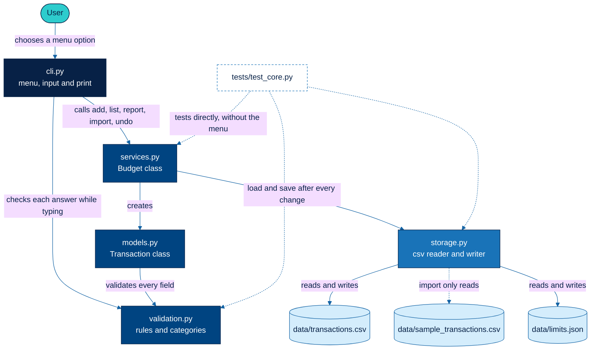
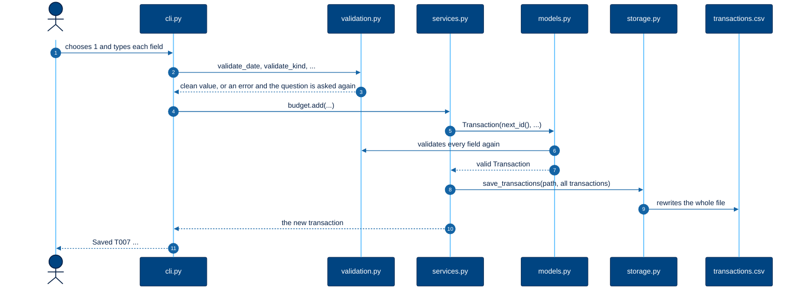

# Design rationale

## Key decision: the program never saves over the file it imports from

The program always works on its own file (`data/transactions.csv`) and only
reads the sample file, never writes to it. I decided this because saving
writes only the valid transactions: if the program saved into the sample
file, its invalid rows would disappear without any warning, which is exactly
the kind of silent change the brief says to avoid. The program even refuses
to start with `--file data/sample_transactions.csv`. For the same reason, every
change (add, import, undo) is saved immediately and the whole file is
rewritten, so the file on disk always matches what the program shows. This
is also what makes undo safe: undo is not just removing an item from a list
in memory, it is saved to the file, so it still works after the program is
closed and opened again.

## How the files work together

Each file has one job. Only `cli.py` talks to the user and only `storage.py`
touches the disk. The dashed arrow to the sample file is the decision above:
the program reads it, but never writes to it.

## Example: adding a transaction

Validation happens twice: once while the user types, so they can fix the
answer right away, and again when the Transaction is created, so nothing
(not even an import or a test) can create an invalid one. The last step
shows the file being rewritten after every change.

## Other decisions in short

- **Unknown categories are rejected, not mapped to "other".** Mapping would
  hide typos like "fod" and the totals by category would be wrong without
  anyone noticing.
- **Values are cleaned but never corrected.** " Food " becomes "food", but a
  negative amount is rejected instead of being made positive, because only
  the user knows what they meant.
- **Reports are calculated per currency.** Adding euros and dollars together
  would give a number that means nothing.
- **Limits are monthly and compared with one month only.** A budget starts
  again every month, so comparing a monthly limit with all-time spending
  would always look "over". Exactly at the limit counts as within it.
- **Limits are saved as JSON, transactions as CSV.** Transactions are a flat
  table of records (CSV), while limits are a small dictionary of settings
  (JSON), as the manual recommends for each format.

## Reflection (exit ticket)

- **What did I verify?** The report totals against numbers calculated by
  hand (income 1,525.00, expenses 728.40, balance 796.60), and that undo
  still holds after closing and reopening the program (test
  `test_undo_is_saved_and_survives_restart`).
- **Which boundary changed my design?** The amount `nan`. Python's
  `float("nan")` is accepted, and `nan <= 0` is `False`, so the first version
  of the check let it through. I changed the rule to `not amount > 0` and
  added a maximum (1,000,000) that also rejects `inf`. Later, adversarial
  testing showed that `float()` also accepts `1e3`, `1_000` and digits of
  other alphabets, so now an amount must first match the pattern of a plain
  number (`re.fullmatch`), and a decimal comma like `18,50` gets its own
  message instead of being guessed.
- **What would I refactor next?** Categories are written in the code, so
  adding one means editing `validation.py`. I would load them from a JSON
  file, like the limits already are, so they can change without touching the
  code. I would also add recurring transactions, such as rent, as a
  `RecurringTransaction` subclass of `Transaction` (inheritance, manual 11.1),
  and limits in other currencies.