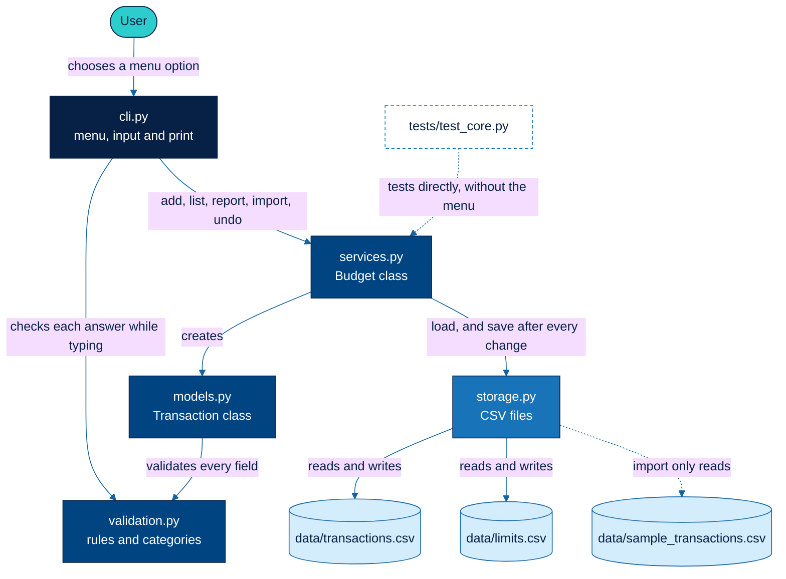

<div align="center">

# 💶 Personal Budget Manager

**Release 1 · Practice 1 · Python I**


A command line program to record my income and expenses, save them to a CSV
file, see monthly reports by category, and set monthly spending limits.
Categories and limits are inspired by the BBVA app ("Mi día a día" and
"Mis presupuestos").

</div>

> [!TIP]
> **Try it in one minute:** `uv sync` → `uv run budget` → choose **6** and press
> Enter twice to import the sample file → choose **4** for the report.
> Tests: `uv run python tests/test_core.py`

## Brief checklist

Where each part of the instructions can be found:

| The instructions asks for | Where it is |
|---|---|
| Add, list and report transactions | Menu options 1, 2, 3 and 4 · [Example](#example) |
| Save and load from file | `storage.py`, saved after every change · [DESIGN.md](DESIGN.md) |
| Validate inputs at entry points | `validation.py` · [Acceptance criteria](#acceptance-criteria) (AC1 to AC31) |
| Transaction schema with predictable fields | [Transaction schema](#transaction-schema) |
| Separated layers (CLI, service, storage) | `cli.py`, `services.py`, `storage.py` · [How it works](#how-it-works) |
| Normal, boundary, malformed and round-trip tests | `tests/test_core.py` · [How to test](#how-to-test) |
| Sample data with valid and invalid rows | `data/sample_transactions.csv` (7 valid in EUR and USD, 11 invalid) |
| Design rationale | [DESIGN.md](DESIGN.md), first paragraph |
| AI disclosure | [AI_DISCLOSURE.md](AI_DISCLOSURE.md) |
| Stretch: undo that survives a restart | Menu option 7 · AC17 |
| Exit ticket reflection | [DESIGN.md](DESIGN.md#reflection-exit-ticket) |

## How it works

Each file has one job: only `cli.py` talks to the user and only `storage.py`
touches the disk, so the logic can be tested without the menu.



> [!IMPORTANT]
> **Key design decision:** the program never saves over the file it imports
> from. The sample file is only read (dashed arrow), because saving keeps only
> the valid rows and would silently delete the invalid ones. Every change is
> saved immediately, so undo still works after closing and reopening.
> Full rationale and a second diagram: [DESIGN.md](DESIGN.md).

## Setup

Requirements: Python 3.12+ and [uv](https://docs.astral.sh/uv/).

```bash
git clone https://github.com/ferreirasara-cpu/Practice-1_-Interactive-Personal-Budget-Manager
cd Practice-1_-Interactive-Personal-Budget-Manager
uv sync
```

## How to run

```bash
uv run budget
```

`budget` is a command defined in `pyproject.toml` that starts
`budget_manager/cli.py`. This also works:
`uv run python -m budget_manager.cli`.

By default the program saves to `data/transactions.csv` (created the first
time). To use another file:

```bash
uv run budget --file data/other.csv
```

```
════════════════════════════════════════════════════════════════════════
                        PERSONAL BUDGET MANAGER
════════════════════════════════════════════════════════════════════════
  File: data/transactions.csv   ·   7 transaction(s)
────────────────────────────────────────────────────────────────────────
   [1]  Add a transaction
   [2]  List all transactions
   [3]  Filter transactions
   [4]  Report
   [5]  Monthly spending limits
   [6]  Import a CSV file
   [7]  Undo last transaction
   [0]  Exit
────────────────────────────────────────────────────────────────────────
```

## Example

**1. Import the sample file** (option 6, then Enter). Valid rows are added and
every invalid row is reported with its row number and the reason:

```
  ✔ Imported 7 transaction(s)
  ✖ 11 row(s) rejected:
      Row 6: amount must be > 0, got -5
      Row 7: amount must be > 0, got 0
      Row 8: date '2026-13-40' does not exist
      Row 9: category 'gym' is not valid for expense. Options: food, health, home, leisure, shopping, transport
      ...
```

**2. List them** (option 2):

```
  ID    DATE        KIND     CATEGORY / SUBCATEGORY               AMOUNT
  ──────────────────────────────────────────────────────────────────────
  T001  2026-09-01  income   salary / payroll              +1,500.00 EUR
  T002  2026-09-02  expense  home / rent                     -650.00 EUR
  T003  2026-09-04  expense  food / supermarket               -18.50 EUR
  T004  2026-09-05  expense  food / restaurants               -24.90 EUR
  T005  2026-09-16  income   other_income / bizum             +25.00 EUR
  T006  2026-09-18  expense  leisure / sports                 -35.00 EUR
  T007  2026-09-20  expense  shopping / electronics           -45.99 USD
  ──────────────────────────────────────────────────────────────────────
  7 transaction(s)
```

**3. Set limits and see the report** (option 5 for food 40, home 650 and
leisure 100, then option 4 and month `2026-09`). There is one report per
currency, and the limits are compared with that month's spending:

```
  2026-09 · EUR
  ─────────────
  Income            1,525.00
  Expenses            728.40
  ──────────────────────────
  Balance             796.60

  Expenses by category
  home              650.00  ██████████████████░░  89%
  food               43.40  █░░░░░░░░░░░░░░░░░░░   6%
  leisure            35.00  █░░░░░░░░░░░░░░░░░░░   5%

  2026-09 · USD
  ─────────────
  Income                0.00
  Expenses             45.99
  ──────────────────────────
  Balance             -45.99

  Expenses by category
  shopping           45.99  ████████████████████ 100%

  Limits for 2026-09 · EUR
  ────────────────────────
  food               43.40 / 40.00  ████████████████████ 108%  ✖ over by 3.40
  home             650.00 / 650.00  ████████████████████ 100%  ✔ 0.00 left
  leisure           35.00 / 100.00  ███████░░░░░░░░░░░░░  35%  ✔ 65.00 left
```

Press Enter instead of a month to see the report for all time.

**4. A wrong answer is explained and asked again** (option 1):

```
  Date (YYYY-MM-DD): 2026-13-01
  ✖ date '2026-13-01' does not exist. Try again.
```

## How to test

```bash
uv run python tests/test_core.py
```

Run it from the project folder (the tests open `data/sample_transactions.csv`).

The 22 tests cover a normal case, boundary cases, malformed rows from the
sample file, the save/load round trip, the report totals, undo after a
restart, imports (a folder instead of a file, the same file twice, a file
separated by `;`), the T999 id limit, monthly reports, and limits (under,
exactly at, and over). Each one prints `✔` when it passes.

## Known limitations

- Ids go up to T999, so one file can hold at most 999 transactions. After
  that, adding or importing shows a clear error and nothing is changed.
- Transactions can't be edited or deleted one by one; only the last one
  added can be undone (undo can be repeated).
- Currencies are not converted, so there is one report per currency.
- Limits are monthly and only in EUR, and the same `data/limits.csv` is used for
  every transactions file.
- Undo only removes transactions; limit changes are not undone (a limit is
  changed or removed from its own menu option).
- Categories are written in the code; adding one means editing validation.py.
- The whole file is rewritten on every change. That's fine for a personal
  budget, but it would be slow with very large files.
- Dates in the future are accepted (useful for planned payments, but a typo
  like 2062 instead of 2026 is not detected).

## Transaction schema

Every transaction has all 7 fields. No field is optional, so every part of
the program can rely on them.

| Field | Type | Allowed values | Example |
|---|---|---|---|
| id | text | `T` + 3 digits, unique, created by the program | `T001` |
| date | text | ISO `YYYY-MM-DD`, must be a real date | `2026-09-04` |
| kind | text | `expense` or `income` | `expense` |
| category | text | one of the categories of that kind (below) | `food` |
| subcategory | text | one of the subcategories of that category | `supermarket` |
| amount | float | greater than 0, at most 1,000,000, at most 2 decimals | `18.50` |
| currency | text | `EUR`, `USD` or `GBP` | `EUR` |

The instructions's schema has 6 fields; I added `subcategory` because the BBVA app
groups spending in two levels (for example food → supermarket / restaurants),
which gives a more useful report.

| Kind | Category | Subcategories |
|---|---|---|
| expense | food | supermarket, restaurants, delivery, general |
| expense | transport | public_transport, fuel, taxi, general |
| expense | home | rent, utilities, internet, general |
| expense | leisure | cinema, travel, sports, general |
| expense | health | pharmacy, doctor, general |
| expense | shopping | clothes, electronics, general |
| income | salary | payroll, bonus, general |
| income | other_income | bizum, refund, general |

Monthly spending limits are saved separately in `data/limits.csv`, with
the columns `category,limit` (for example `food,300.00`). The program only
uses CSV files, no database. A limit can only be set on an
expense category, its amount follows the same rules as a transaction amount,
and limits are monthly and in EUR.

## Acceptance criteria

Each rule is a behavior that can be checked with a concrete input.
AC1 to AC31 (except AC27) are checked in `tests/test_core.py`; AC27 is
checked by running the command shown.

<details>
<summary><b>Show the 31 acceptance criteria</b></summary>

| # | Input | Expected result |
|---|---|---|
| AC1 | `2026-09-04, expense, food, supermarket, 18.50, EUR` | Accepted, amount stored as 18.5 |
| AC2 | Category ` Food `, currency `eur` | Accepted as `food` and `EUR` (cleaned) |
| AC3 | Amount `0` | Rejected: `amount must be > 0, got 0` |
| AC4 | Amount `-5` | Rejected: `amount must be > 0, got -5` (never made positive) |
| AC5 | Amount `0.01` / `1000000` | Accepted (the limits are included) |
| AC6 | Amount `18.555` | Rejected: `amount can have at most 2 decimals` (never rounded) |
| AC7 | Amount `abc`, `nan`, `inf`, `1e3`, `1_000` | Rejected: `amount must be a number like 18.50` (`float()` alone would accept the last four) |
| AC8 | Date `2026-13-40` / `2025-02-29` | Rejected: `date '...' does not exist` |
| AC9 | Date `2024-02-29` | Accepted (leap year) |
| AC10 | Category `gym` | Rejected and the valid options are listed (not mapped to "other") |
| AC11 | `income` with category `food` | Rejected: the category must belong to the kind |
| AC12 | `food` with subcategory `cinema` | Rejected: the subcategory must belong to the category |
| AC13 | Currency `JPY` | Rejected: only EUR, USD, GBP |
| AC14 | The same id twice in a file | First row kept, second reported: `Row N: id T003 is repeated` |
| AC15 | Importing the sample file | 7 accepted, 11 rejected, each with its row number |
| AC16 | Import a file that does not exist | `file '...' was not found` (not "Imported 0") |
| AC17 | Undo, then close and reopen | The removed transaction is still gone |
| AC18 | Report with EUR and USD | One report per currency, never added together |
| AC19 | Month `2026-13` | Rejected: `month '2026-13' does not exist` |
| AC20 | Report for `2026-10` | Only October transactions are counted |
| AC21 | Limit on `salary` (income) | Rejected: limits are only for expense categories |
| AC22 | Spent 650.00 with a limit of 650.00 | Not over: `✔ 0.00 left` (the limit itself is allowed) |
| AC23 | Spent 43.40 with a limit of 40.00 | Over: `✖ over by 3.40` |
| AC24 | `limits.csv` with `gym,50`, a repeated category, or a wrong first line | Bad limits reported with their row number, the rest still load, no crash |
| AC25 | Import `data` (a folder, not a file) | `file 'data' was not found` (no crash) |
| AC26 | Add a transaction after T999 | Rejected: `the file is full: ids only go up to T999`; an import that does not fit adds nothing |
| AC27 | `uv run budget --file data/sample_transactions.csv` | Refused: the sample file is only for importing, so its invalid rows are never lost |
| AC28 | Import the sample file twice | The second time adds nothing: each repeated row is reported as `already in your budget, not imported again`, totals do not double |
| AC29 | Amount `18,50` (decimal comma) | Rejected: `amount must use a dot for decimals and no commas, like 18.50` (never guessed) |
| AC30 | Month `２０２６-０９` (full-width digits) | Rejected: `month must be YYYY-MM` (only the digits 0 to 9 are accepted) |
| AC31 | A CSV separated by `;` (Spanish Excel) | One clear error: `has no column(s) id, date, ...`, instead of one error per row |

</details>

## Reference

<details>
<summary><b>Project structure</b></summary>

```
├── data/
│   ├── sample_transactions.csv   # sample data with valid and invalid rows
│   ├── transactions.csv          # created by the program (not on GitHub)
│   └── limits.csv                # created by the program (not on GitHub)
├── src/budget_manager/
│   ├── models.py                 # the Transaction class
│   ├── validation.py             # the rules and the category lists
│   ├── services.py               # the Budget class: add, list, filter, report, import, undo
│   ├── storage.py                # reading and writing the CSV files
│   └── cli.py                    # the menu (the only file with input() and print())
├── tests/
│   └── test_core.py              # tests written with assert
├── pyproject.toml                # project settings and the "budget" command
├── README.md
├── DESIGN.md                     # design rationale and diagrams
└── AI_DISCLOSURE.md              # how AI was used
```

</details>

<details>
<summary><b>Every feature and rule, with the Python tool used</b></summary>

### Features

Every function has a docstring and type hints, as contracts (manual 4.1).
The only exception: parameters that receive a function (`check`, `action`)
have no type hint, because that needs a tool we did not see in class.

- Transaction -> a class with __init__ that checks every field before
  saving it, so an invalid transaction can never exist (models.py)
- Create a transaction from a CSV row -> @classmethod from_dict(row) (models.py)
- Turn a transaction back into a row -> to_dict() returning a dictionary (models.py)
- Amount with its sign for the balance -> @property signed_amount (models.py)
- Budget -> a class that contains the list of transactions (composition)
  and saves the file after every change (services.py)
- Protect the list from outside changes -> stored as _transactions and shown
  through a @property that returns a copy (encapsulation) (services.py)
- Last transaction for undo -> @property last_transaction (services.py)
- Menu -> while True loop with input(), a dictionary that maps each option
  to its function, break to exit (cli.py)
- Ask again until the answer is valid -> while True with try / except (cli.py)
- Optional filters that still reject typos -> a function that returns a
  lambda (cli.py)
- Choose the data file when starting -> argparse with a --file option (cli.py)
- Start with "uv run budget" -> [project.scripts] in pyproject.toml
- Add a transaction -> list.append() and save (services.py)
- Automatic id (T001, T002...) -> max() of the existing numbers + 1 (0 when
  there are none, with a conditional expression)
  and the f-string f"T{number:03d}" (services.py)
- List transactions -> sorted(key=lambda t: (t.date, t.id)) (services.py)
- Filter by kind or category -> list comprehension with a condition (services.py)
- Totals by category -> dictionary built with totals.get(category, 0) + amount (services.py)
- Percentage of each category -> dictionary comprehension, calculated in
  services.py so the CLI only shows it (services.py)
- Total income, total expenses and balance -> sum() over generator
  expressions and round(x, 2) (services.py)
- Report per currency -> set comprehension to find the currencies used (services.py)
- Import a CSV file -> load the other file and give each valid row a new id;
  the other file is only read, never written (services.py)
- A folder or a missing file can't be imported -> Path(path).is_file() (services.py)
- Never open the sample file as the working file -> comparing two Path
  objects with == (cli.py)
- Save to file -> with open(..., "w", newline="") and csv.DictWriter (storage.py)
- Load from file -> csv.DictReader, enumerate(start=2), pathlib.Path (storage.py)
- Undo last transaction -> list.pop() and save the whole file again, so the
  file always matches the program, even after a restart (services.py)
- Monthly report and filter -> t.date.startswith(month) and slicing
  t.date[:7] to list the months used (services.py)
- One rule for "this currency and this month" -> a private helper method
  _select() used by every query (services.py)
- Monthly limits saved to a second CSV file -> csv.DictReader /
  csv.DictWriter with the columns category,limit in data/limits.csv (storage.py)
- Set or remove a limit -> dictionary assignment and dict.pop() (services.py)
- Spent vs. limit -> a list of dictionaries, one per category, sorted by
  percentage used (services.py)
- Tables, report and bars -> f-string alignment (:<10, :>14, :,.2f),
  .center() and string repetition ("█" * n) (cli.py)

### Rules

Each transaction has: id, date, kind, category, subcategory, amount, currency.
All fields are required.

- Required fields -> .strip() and raise ValueError if empty
- Clean spaces and capitals -> .strip(), .lower(), .upper()
- Id must look like T001 and can't repeat -> re.fullmatch(r"T[0-9]{3}") and a
  set of ids already seen
- Date must be a real date in YYYY-MM-DD -> re.fullmatch for the format,
  then date.fromisoformat() to reject dates like 2026-13-40
- Kind is expense or income -> "in" a set
- Filter category may belong to any kind -> set union of both dictionaries' keys
- Category must exist for that kind -> two dictionaries, EXPENSE_CATEGORIES
  and INCOME_CATEGORIES, checked with "in"
- Subcategory must belong to its category -> each category holds a list of
  its subcategories, checked with "in"
- Amount is a plain number like 18.50 -> "," in text for a clear message,
  then re.fullmatch(r"-?[0-9]+(\.[0-9]+)?") before float(), so "1e3",
  "1_000", "nan" and "inf" are rejected
- Amount greater than 0, at most 1,000,000, at most 2 decimals -> comparisons,
  and re.fullmatch with [0-9]{1,2} for the decimals
- Only the digits 0 to 9 in ids, dates and months -> [0-9] instead of \d,
  which also accepts digits of other alphabets
- Importing the same transactions twice does not count them twice -> a set
  of tuples (date, kind, category, subcategory, amount, currency) and "in"
- A file separated by ";" gives one clear error -> a list comprehension of
  the columns missing from the row dictionary
- Currency must be EUR, USD or GBP -> "in" a set
- Clear error messages -> raise ValueError(f"amount must be > 0, got {value}")
- Bad rows don't stop the file from loading -> try / except / else inside the
  loop, enumerate(rows, start=2) for the row number, accepted and rejected lists
- Values are cleaned but never corrected: a negative amount is rejected, not
  turned positive, and a bad date is never guessed
- Reports are shown separately for each currency, never added together
- Month must be YYYY-MM with a month from 01 to 12 -> re.fullmatch and
  slicing text[5:] with int()
- A limit only for expense categories -> reuses validate_category("expense", ...)
- A limit amount -> reuses validate_amount, so the same rules apply
- A bad limits file never crashes the program -> try / except / else per
  row with its row number, a set check for repeated categories, and one
  message if the first line is wrong


</details>
